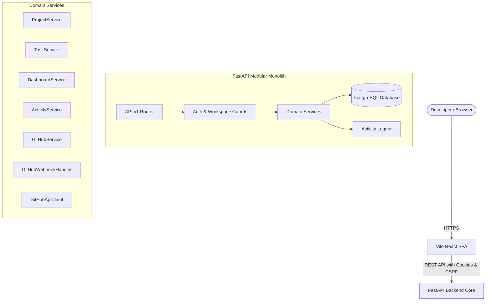

# MySDE — Architecture Design Document

**Document Version:** 3.0.0  
**Phase:** Phase 3 (Projects, Tasks, and API-Connected Dashboard)  
**System Classification:** Modular Monolith SaaS Architecture  

---

## 1. System Architecture Overview

MySDE uses a **Modular Monolith** architecture. All core SaaS functionality, domain services, and database access are maintained within a unified backend service, while compute-intensive agent runs, test executions, and sandbox operations are dispatched asynchronously to dedicated worker processes and containerized sandboxes.



---

## 2. Frontend / Backend Boundaries

### 2.1 Backend Responsibilities
- **Authentication & Multi-Tenant Authorization:** Enforcing workspace-level access control.
- **Data Persistence:** Storing metadata, projects, tasks, audit trails, and user configurations in PostgreSQL.
- **Domain Services:**
  - `ProjectService`: Project CRUD, slug generation, archiving, task count aggregation.
  - `TaskService`: Task lifecycle management, validation of status transitions (`completed_at`), archived project checks, workspace assignee validation.
  - `DashboardService`: Aggregated metrics for active projects, open tasks, in-progress tasks, and completed tasks.
  - `ActivityService`: Audit event emission without leaking credentials.
  - `GitHubService`: GitHub App installations, repository metadata syncing, and workspace project binding.
  - `GitHubWebhookHandler`: HMAC SHA-256 signature verification and idempotent event ingestion.
  - `GitHubApiClient`: RS256 JWT signing, short-lived installation access tokens, and GitHub REST API integration.

### 2.2 Frontend Responsibilities
- **Presentation & State Management:** Single Page Application (SPA) built with React 18, Vite, and TanStack Query v5.
- **Tenant-Scoped Data Caching:** TanStack Query keys are explicitly partitioned by `activeWorkspace.id` (e.g. `['projects', workspaceId]`, `['tasks', workspaceId]`, `['dashboard', 'summary', workspaceId]`).
- **Workspace Switching:** Seamlessly invalidates stale queries and synchronizes active workspace context across all views.
- **Zero Secrets Rule:** Frontend never receives or stores raw repository tokens, GitHub App private keys, or LLM credentials.

---

## 3. API Architecture & Layering

The backend enforces strict separation of concerns through architectural layering:

```text
HTTP Request
     │
     ▼
[Endpoints / Controllers]  ── (Thin layer: validates DTOs, parses headers, returns responses)
     │
     ▼
[FastAPI Dependencies]     ── (Resolves session, verifies workspace membership, validates permissions)
     │
     ▼
[Domain Services]          ── (Business logic, status state transitions, transactions, activity logs)
     │
     ▼
[Database / Models]        ── (PostgreSQL schema entities via SQLAlchemy 2.0 ORM)
```

- **Endpoints (`app/api/v1/endpoints/`):** Thin route handlers that validate request payloads using Pydantic v2 schemas and delegate directly to domain services.
- **Dependencies (`app/api/deps.py`):**
  - `get_current_user`: Authenticates session from `mysde_session` cookie.
  - `resolve_project_workspace`: Fetches project and verifies active membership in owning workspace.
  - `resolve_task_workspace`: Fetches task and verifies active membership in owning workspace.
- **Domain Services (`app/services/`):** Houses business rules, state machines, and transactional coordination.
- **Models (`app/models/`):** SQLAlchemy ORM models with cross-dialect support (`app.db.base.GUID` for UUIDs).

---

## 4. Database Access Strategy

1. **SQLAlchemy 2.x:** Modern 2.0 style syntax (`select()`, `scalars()`) with strict typing.
2. **Session Lifecycle:** FastAPI dependency injection (`get_db`) yields database sessions with deterministic scope.
3. **Connection Pooling:** Configured with `pool_pre_ping=True`, conservative `pool_size` (10-20), and `max_overflow` (10).
4. **Migration Strategy:** Forward-only Alembic migrations (`20261019_0001`, `20261019_0002`).

---

## 5. Security & Authorization

- **Multi-Tenant Isolation:** Every task and project is bound to a `workspace_id`. Cross-workspace reads, mutations, or project reassignments return HTTP 404 to prevent resource enumeration.
- **Archival Protection:** Archived projects cannot receive new tasks until explicitly restored.
- **Assignee Authorization:** Tasks can only be assigned to valid members of the owning workspace.
- **CSRF Protection:** State-changing methods require `X-CSRF-Token` matching the client's `mysde_csrf` cookie.

---

## 6. LangGraph Orchestration & AI Planning Architecture (Phase 6)

Phase 6 introduces a deterministic, observable, evidence-grounded planning agent orchestrated with LangGraph:

```text
       [load_task]
            │
            ▼
     [validate_context] ──(missing prerequisites)──► [finalize_run (needs_context)]
            │
            ▼
[retrieve_repository_context]
            │
            ▼
       [analyze_task]
            │
            ▼
      [generate_plan] ◄────────────────┐
            │                          │
            ▼                          │ (repair loop: retry_count <= max_retries)
      [validate_plan] ──(invalid)──────┘
            │
    (valid schema)
            │
            ▼
      [persist_plan]
            │
            ▼
      [finalize_run (completed)]
```

### 6.1 State Schema (`PlanningState`)
A typed TypedDict carrying only execution essentials:
- `run_id`, `task_id`, `workspace_id`, `user_id`
- `status`: `queued` | `running` | `completed` | `failed` | `cancelled` | `needs_context`
- `retrieved_chunks`: List of normalized Code RAG chunks
- `evidence`: Normalized `PlanEvidenceItem` records with chunk IDs, commit SHAs, file paths, line numbers, and excerpts
- `prompt_text`: Untrusted data-isolated prompt with strict boundary markers
- `plan`: Validated `ImplementationPlanSchema` dictionary
- `validation_errors`: Error diagnostics used by the bounded repair loop
- `retry_count` & `max_retries`: Explicit recursion bounding

### 6.2 Evidence-Grounded Planning Contract
- Every claimed existing file, function, or symbol must reference a real item in the run's retrieved evidence collection (`evidence_refs`).
- Symbols and files without retrieved evidence must be explicitly marked with `location_status = "proposed_new"` or `"hypothetical_investigation"`.
- If a repository's default branch has moved past the indexed commit SHA, the plan explicitly flags that it was generated against an earlier snapshot.

### 6.3 Security Policy & Untrusted Data Boundary
- All repository code, commit messages, issue bodies, and task descriptions are treated as **untrusted data**.
- Prompts use explicit XML delimiters (`<task_specification>`, `<repository_code_context>`).
- System instructions explicitly forbid executing user instructions embedded in code or issue text.
- **Strict Scope Boundary:** The planning agent has **no** tool execution capabilities, cannot edit or commit repository files, cannot run shell commands, and cannot create PRs.

---

## 7. Isolated Code Execution & Sandbox Architecture (Phase 7)

Phase 7 introduces the secure, isolated execution environment where approved implementation plans are converted into unified git diff proposals, reviewed by humans, and applied inside an OS-enforced container sandbox before executing permitted verification checks.

```text
[Approved Plan] ──► [Snapshot Preparation] ──► [Patch Generation] ──► [Patch Validation]
                                                                             │
                                                                             ▼
[Human Review & Approval] ◄───────────────────────────────────── [awaiting_patch_approval]
          │
      (Approve)
          │
          ▼
 [Provision Sandbox] ──► [Apply Patch (git apply)] ──► [Run Permitted Checks] ──► [Collect Diff & Evidence]
                                                                                          │
                                                                                          ▼
                                                                           [Destroy Sandbox & Cleanup]
```

### 7.1 Security Boundaries & Isolation Policy
1. **Container Security Flags (Docker)**:
   - Dedicated unprivileged user (`--user 1000:1000`)
   - Read-only container root filesystem (`--read-only`)
   - Complete network isolation (`--network none`)
   - All Linux kernel capabilities dropped (`--cap-drop ALL`)
   - No privilege escalation allowed (`--security-opt no-new-privileges:true`)
   - Kernel resource limits: memory (`1024m`), CPU quota (`1.0`), process limits (`--pids-limit 100`)
   - Host isolation: Only a disposable per-run temporary directory is mounted to `/workspace`. Never mounts host project root, user home, or the Docker daemon socket (`/var/run/docker.sock`).
2. **Patch Validation Policy (`PatchValidator`)**:
   - Rejects absolute paths (`/etc/passwd`, `C:\...`) and directory traversals (`../`).
   - Rejects binary diffs (`GIT binary patch`) and symlink creation/escapes (`mode 120000`).
   - Rejects modifications to protected files (`.git/`, `.env`, `secrets.*`, `credentials.*`, `id_rsa`, `.github/workflows/*`).
   - Bounds maximum patch size (500 KB default) and maximum changed files (20 default).
3. **Command Policy (`CommandPolicy`)**:
   - Server-side fixed allowlist: `pytest`, `ruff_check`, `npm_test`, `npm_lint`, `syntax_check`.
   - Never executes arbitrary shell strings or user-supplied command interpolations.
   - Rejects all shell metacharacters (`;`, `|`, `&`, `$`, `` ` ``, `>`, `<`, `\n`, `\r`).
   - Bounds command timeout (60s default) and bounds captured stdout/stderr (20 KB default).
   - Redacts credentials, tokens, AWS keys, and private keys from saved logs.
4. **Human Approval Gate**:
   - Execution runs always pause at `awaiting_patch_approval`.
   - No patch is ever applied or executed without an explicit authenticated human approval decision.

---

## 8. Bounded AI Repair Loops & Verification (Phase 8)

Phase 8 implements an evidence-driven, bounded repair loop that analyzes failed verification checks from Phase 7 execution runs, classifies defects, proposes corrective patches, validates them against strict anti-cheating rules, applies them inside the sandbox, and reruns approved verification checks within strictly enforced server budgets.

```text
       [load_execution_run]
               │
               ▼
   [collect_failure_evidence]
               │
               ▼
       [classify_failure] ────(non-repairable failure: timeout/sandbox/infra)──► [finalize_repair_run]
               │
               ▼ (repairable: assertion/syntax/lint/type)
  [retrieve_relevant_context]
               │
               ▼
        [propose_repair] ◄─────────────────────────────────────────────┐
               │                                                       │
               ▼                                                       │
     [validate_repair_patch] ──(anti-cheating violation / invalid)─────┼─► [evaluate_outcome]
               │                                                       │          │
               ▼ (valid patch)                                         │          │
      [apply_repair_patch] ──(application failure)─────────────────────┤          │
               │                                                       │          │
               ▼                                                       │          │
      [rerun_verification]                                             │          │
               │                                                       │          │
               ▼                                                       │          │
       [evaluate_outcome] ──(all checks passed)──► [finalize_repair_run]          │
               │                                                                  │
               └────(failed & attempts < max & time < deadline & calls < quota)───┘
```

### 8.1 Repair Graph State & Transition Rules
- **State Schema (`RepairState`)**:
  - `execution_run_id`, `repair_run_id`, `attempt_number`, `max_attempts` (default 3), `consumed_attempts`
  - `max_duration_seconds` (default 600s), `deadline_at_iso`, `max_model_calls` (default 6), `consumed_model_calls`
  - `current_patch_hash`, `base_commit_sha`, `failure_classification`, `evidence_items`, `repair_proposal`, `application_result`, `verification_results`, `all_passed`
- **Transitions**:
  - `classify_failure` routes directly to `finalize_repair_run` with outcome `non_repairable_failure` if the failure category is infrastructure, timeout, resource limit, network denied, sandbox failure, dependency/config error, or unknown.
  - `evaluate_outcome` verifies `all_passed`. If true, marks `verified_success`. If false and budgets are exhausted (attempts >= 3 or calls >= 6 or now >= deadline), transitions to `finalize_repair_run` with `budget_exhausted`. Otherwise, loops back to `propose_repair`.

### 8.2 Failure Classification Policy
- **Repairable Categories**:
  - `test_assertion_failure`: Deterministic unit/integration test assertion failures.
  - `syntax_error`: Syntax errors in modified files.
  - `lint_failure`: Linter/formatter rule violations (`ruff`, `flake8`, `eslint`).
  - `type_or_static_analysis_error`: Static type check failures (`mypy`, `tsc`).
- **Non-Repairable Categories**:
  - `sandbox_failure`, `resource_limit_exceeded`, `timeout`, `network_denied`, `environment_failure`, `configuration_error`, `import_or_dependency_error`, `unknown`.
- **Classification Engine**:
  - Extracts evidence deterministically from `verification_results` using regex matching.
  - Redacts sensitive secrets, credentials, tokens, and host paths using `CommandPolicy.sanitize_and_truncate_output()`.

### 8.3 Anti-Cheating & Patch Safety Policy
The `RepairGenerator` and `PatchValidator` enforce strict invariant checks before applying any corrective patch:
1. **No Test Deletion**: Rejects patches that delete test files (`test_*.py`, `*_test.py`, `*.spec.js`, `*.test.js`) or remove test functions/cases.
2. **No Assertion Weakening**: Flags and rejects patches that remove assertions or replace assertions with dummy passes/mocks.
3. **No Dependency/Manifest Manipulation**: Prohibits changes to package manifests and lockfiles (`package.json`, `pyproject.toml`, `requirements.txt`, `poetry.lock`, `yarn.lock`, etc.).
4. **Patch Integrity**: Enforces Phase 7 path security (no directory traversal `../`, no absolute paths, no symlink escapes `mode 120000`, no protected files `.git/`, `.env`, secrets).

---

## 9. SaaS Billing, Subscription Plans, and Usage Metering Architecture

### 9.1 Tenant & Billing Model
- **Workspace Billing Ownership**: Subscriptions are scoped strictly to the `workspace_id`. The billing owner is tracked by `billing_owner_id` (a workspace member with `owner` role). Team members inherit the workspace's plan quotas.
- **Configurable Tiers (`subscription_plans`)**:
  - `free`: ₹0 / $0 per month, 15 agent runs, 5 repairs, 250k tokens, max 1 parallel run.
  - `pro`: ₹2,499 / $29 per month, 100 agent runs, 50 repairs, 2M tokens, max 3 parallel runs.
  - `team`: ₹7,999 / $99 per month, 500 agent runs, 250 repairs, 10M tokens, max 10 parallel runs.
- **Grace Periods & Standing**: Past due subscriptions retain a 3-day grace window before plan privileges are revoked (`HTTP 402 PAYMENT_REQUIRED`).

### 9.2 Auditable Usage Ledger (`usage_ledger_entries`)
- **Event-Driven Metering**: Backend services record billable events (`agent_run_started`, `agent_run_completed`, `repair_run_started`, `model_request_completed`) with quantity, operation ID, model tokens, and estimated cost.
- **Idempotency**: Unique database constraint `uq_usage_ledger_operation_event (operation_id, event_type)` ensures network retries never double-charge.
- **Zero Client Trust**: Quotas and usage calculations execute exclusively server-side using PostgreSQL aggregate sums within `current_period_start` and `current_period_end`.

### 9.3 Centralized Server-Side Enforcement (`BillingService.enforce_quota`)
- **Pessimistic Row Locking**: Uses `select(Subscription).with_for_update()` to prevent race conditions across parallel agent run requests.
- **Concurrency & Quota Bounds**: Evaluates active parallel runs against `max_parallel_runs` (returning `HTTP 429 TOO_MANY_REQUESTS`) and monthly consumption against `monthly_agent_runs` / `monthly_repair_runs` (returning `HTTP 402 PAYMENT_REQUIRED` with structured `QUOTA_EXCEEDED` payload).

### 9.4 Payment Provider Integration & Webhook Security
- **Provider Neutrality**: Clean interface `BaseBillingProvider` implemented by `MockBillingProvider` (offline dev/testing) and `RazorpayBillingProvider` (India-compatible subscriptions).
- **HMAC Signature Verification**: Inbound webhooks (`POST /api/v1/billing/webhooks/{provider}`) verify cryptographic signatures using `hmac.compare_digest` over raw request bytes before parsing.
- **Idempotency Ledger (`processed_webhook_events`)**: Webhook event IDs are stored with unique constraints, rendering duplicates idempotent no-ops.
