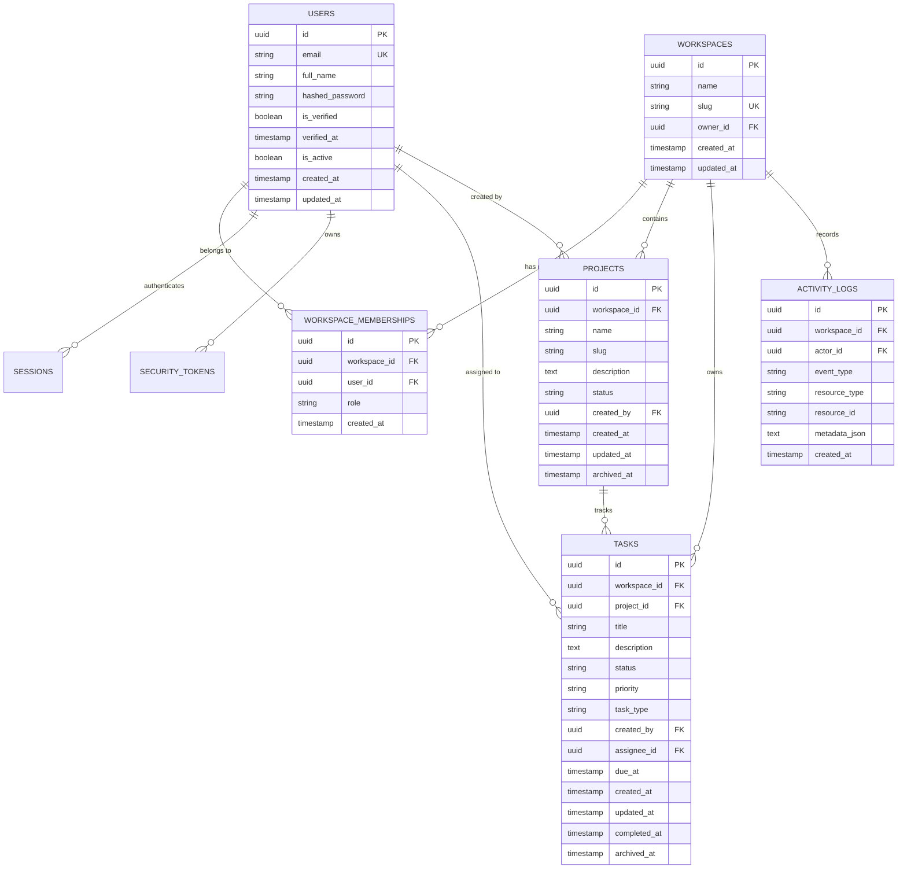

# MySDE — Database Design & Schema Specification

**Document Version:** 3.0.0  
**Phase:** Phase 3 (Projects, Tasks, and API-Connected Dashboard)  
**RDBMS:** PostgreSQL 15+ (SQLite supported in tests)  
**ORM:** SQLAlchemy 2.x  
**Migration Tool:** Alembic  

---

## 1. Schema Overview & Entity Relationship Diagram

The MySDE database is organized around strict workspace multi-tenancy. Every core project asset belongs to an isolated `workspace`.

---

## 2. Implemented Models

### 2.1 Core Authentication & Multi-Tenancy (Migration `20261019_0001`)

- `users`: Accounts with argon2id hashed passwords and verification state.
- `workspaces`: Tenant organizational containers with unique system-wide slug.
- `workspace_memberships`: Role-based access control (`owner`, `admin`, `member`).
- `sessions`: Ephemeral token hashes for HttpOnly session authentication.
- `security_tokens`: Single-use tokens for email verification and password resets.

---

### 2.2 Projects, Tasks & Activity Logs (Migration `20261019_0002`)

#### 2.2.1 `projects`
- `id` (UUID, Primary Key)
- `workspace_id` (UUID, Foreign Key -> `workspaces.id` ON DELETE CASCADE, Indexed)
- `name` (VARCHAR(128), Not Null)
- `slug` (VARCHAR(128), Not Null)
- `description` (TEXT, Nullable)
- `status` (VARCHAR(32), Not Null, Default "active") — "active", "archived"
- `created_by` (UUID, Foreign Key -> `users.id` ON DELETE SET NULL, Nullable)
- `created_at` (TIMESTAMPTZ, Default NOW())
- `updated_at` (TIMESTAMPTZ, Default NOW())
- `archived_at` (TIMESTAMPTZ, Nullable)
- **Constraints & Indexes:**
  - `UNIQUE(workspace_id, slug)`: Slugs are unique within the workspace, but distinct workspaces may reuse the same slug.
  - `idx_projects_workspace_status`: Composite index on `(workspace_id, status)` for fast dashboard & list queries.

#### 2.2.2 `tasks`
- `id` (UUID, Primary Key)
- `workspace_id` (UUID, Foreign Key -> `workspaces.id` ON DELETE CASCADE, Indexed)
- `project_id` (UUID, Foreign Key -> `projects.id` ON DELETE CASCADE, Indexed)
- `title` (VARCHAR(255), Not Null)
- `description` (TEXT, Nullable)
- `status` (VARCHAR(32), Not Null, Default "todo") — "backlog", "todo", "in_progress", "in_review", "done", "cancelled"
- `priority` (VARCHAR(32), Not Null, Default "medium") — "low", "medium", "high", "critical"
- `task_type` (VARCHAR(32), Not Null, Default "feature") — "feature", "bug", "improvement", "chore"
- `created_by` (UUID, Foreign Key -> `users.id` ON DELETE SET NULL, Nullable)
- `assignee_id` (UUID, Foreign Key -> `users.id` ON DELETE SET NULL, Nullable)
- `due_at` (TIMESTAMPTZ, Nullable)
- `created_at` (TIMESTAMPTZ, Default NOW())
- `updated_at` (TIMESTAMPTZ, Default NOW())
- `completed_at` (TIMESTAMPTZ, Nullable)
- `archived_at` (TIMESTAMPTZ, Nullable)
- **Constraints & Indexes:**
  - `idx_tasks_workspace_status`: Composite index on `(workspace_id, status)`.
  - `idx_tasks_project_status`: Composite index on `(project_id, status)`.
  - `idx_tasks_assignee`: Index on `(workspace_id, assignee_id)`.
  - Lifecycle Rules: Setting status to `done` automatically records `completed_at = NOW()`; transitioning back clears `completed_at`.

#### 2.2.3 `activity_logs`
- `id` (UUID, Primary Key)
- `workspace_id` (UUID, Foreign Key -> `workspaces.id` ON DELETE CASCADE, Indexed)
- `actor_id` (UUID, Foreign Key -> `users.id` ON DELETE SET NULL, Nullable)
- `event_type` (VARCHAR(64), Not Null) — "project_created", "project_archived", "task_created", "task_status_changed", "task_completed", etc.
- `resource_type` (VARCHAR(64), Not Null) — "project", "task"
- `resource_id` (VARCHAR(64), Not Null)
- `metadata_json` (TEXT, Nullable) — JSON serialized dictionary (sanitized of tokens or passwords)
- `created_at` (TIMESTAMPTZ, Default NOW())
- **Indexes:**
  - `idx_activity_workspace_created`: Composite index on `(workspace_id, created_at DESC)` for high-performance reverse chronological feed queries.

---

### 2.3 GitHub App Integration (Migration `20261019_0003`)

#### 2.3.1 `github_installations`
- `id` (UUID, Primary Key)
- `workspace_id` (UUID, Foreign Key -> `workspaces.id` ON DELETE CASCADE, Unique, Indexed)
- `installation_id` (BIGINT, Unique, Indexed) — External GitHub installation ID
- `account_login` (VARCHAR(255), Not Null) — GitHub organization or user handle
- `account_type` (VARCHAR(64), Default "User") — "User" or "Organization"
- `account_avatar_url` (VARCHAR(512), Nullable)
- `status` (VARCHAR(32), Default "active") — "active", "uninstalled", "suspended"
- `permissions_json` (TEXT, Nullable)
- `uninstalled_at` (TIMESTAMPTZ, Nullable)
- `created_at` (TIMESTAMPTZ, Default NOW())
- `updated_at` (TIMESTAMPTZ, Default NOW())

#### 2.3.2 `github_repositories`
- `id` (UUID, Primary Key)
- `workspace_id` (UUID, Foreign Key -> `workspaces.id` ON DELETE CASCADE, Indexed)
- `installation_id` (UUID, Foreign Key -> `github_installations.id` ON DELETE CASCADE, Indexed)
- `github_repo_id` (BIGINT, Not Null, Indexed) — Stable GitHub external repository ID
- `owner_login` (VARCHAR(255), Not Null)
- `name` (VARCHAR(255), Not Null)
- `full_name` (VARCHAR(512), Not Null, Indexed)
- `default_branch` (VARCHAR(128), Default "main")
- `is_private` (BOOLEAN, Default True)
- `is_archived` (BOOLEAN, Default False)
- `is_selected` (BOOLEAN, Default False, Indexed) — Selected for workspace project association
- `last_synced_at` (TIMESTAMPTZ, Nullable)
- `created_at` (TIMESTAMPTZ, Default NOW())
- `updated_at` (TIMESTAMPTZ, Default NOW())
- **Constraint:** `UNIQUE(workspace_id, github_repo_id)`

#### 2.3.3 `github_oauth_states`
- `id` (UUID, Primary Key)
- `workspace_id` (UUID, Foreign Key -> `workspaces.id` ON DELETE CASCADE, Indexed)
- `user_id` (UUID, Foreign Key -> `users.id` ON DELETE CASCADE, Indexed)
- `state_token` (VARCHAR(64), Unique, Indexed) — Cryptographically secure single-use token
- `expires_at` (TIMESTAMPTZ, Indexed) — 15 minute lifespan
- `consumed_at` (TIMESTAMPTZ, Nullable)
- `created_at` (TIMESTAMPTZ, Default NOW())

#### 2.3.4 `github_webhook_deliveries`
- `id` (UUID, Primary Key)
- `delivery_id` (VARCHAR(128), Unique, Indexed) — GitHub delivery ID for idempotency
- `event_type` (VARCHAR(64), Not Null)
- `action` (VARCHAR(64), Nullable)
- `status` (VARCHAR(32), Default "processed")
- `created_at` (TIMESTAMPTZ, Default NOW())

#### 2.3.5 Project & Task Extensions
- `projects.repository_id` (UUID -> `github_repositories.id` ON DELETE SET NULL, Nullable, Indexed)
- `tasks.repository_id` (UUID -> `github_repositories.id` ON DELETE SET NULL, Nullable, Indexed)
- `tasks.github_issue_number` (INTEGER, Nullable)
- `tasks.github_issue_url` (VARCHAR(512), Nullable)
- `tasks.github_issue_id` (BIGINT, Nullable, Indexed)
