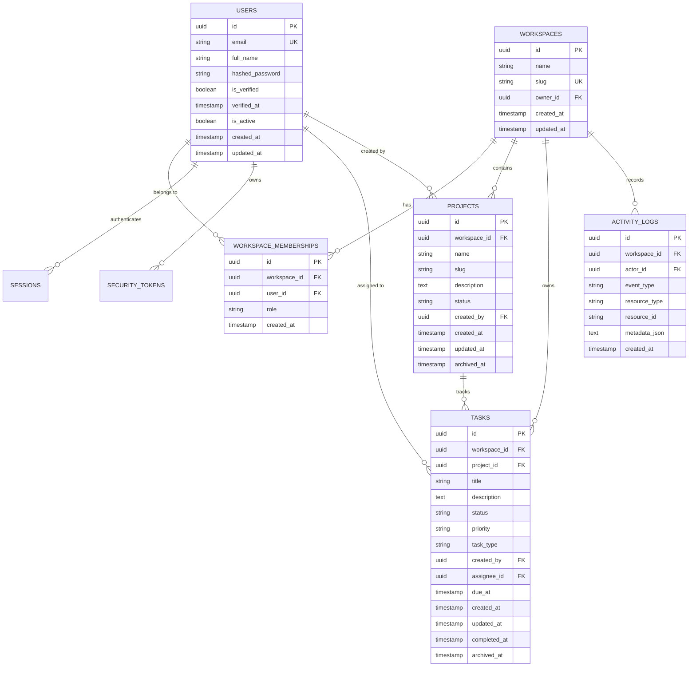

# MySDE — Database Design & Schema Specification

**Document Version:** 3.0.0  
**Phase:** Phase 3 (Projects, Tasks, and API-Connected Dashboard)  
**RDBMS:** PostgreSQL 15+ (SQLite supported in tests)  
**ORM:** SQLAlchemy 2.x  
**Migration Tool:** Alembic  

---

## 1. Schema Overview & Entity Relationship Diagram

The MySDE database is organized around strict workspace multi-tenancy. Every core project asset belongs to an isolated `workspace`.

---

## 2. Implemented Models

### 2.1 Core Authentication & Multi-Tenancy (Migration `20261019_0001`)

- `users`: Accounts with argon2id hashed passwords and verification state.
- `workspaces`: Tenant organizational containers with unique system-wide slug.
- `workspace_memberships`: Role-based access control (`owner`, `admin`, `member`).
- `sessions`: Ephemeral token hashes for HttpOnly session authentication.
- `security_tokens`: Single-use tokens for email verification and password resets.

---

### 2.2 Projects, Tasks & Activity Logs (Migration `20261019_0002`)

#### 2.2.1 `projects`
- `id` (UUID, Primary Key)
- `workspace_id` (UUID, Foreign Key -> `workspaces.id` ON DELETE CASCADE, Indexed)
- `name` (VARCHAR(128), Not Null)
- `slug` (VARCHAR(128), Not Null)
- `description` (TEXT, Nullable)
- `status` (VARCHAR(32), Not Null, Default "active") — "active", "archived"
- `created_by` (UUID, Foreign Key -> `users.id` ON DELETE SET NULL, Nullable)
- `created_at` (TIMESTAMPTZ, Default NOW())
- `updated_at` (TIMESTAMPTZ, Default NOW())
- `archived_at` (TIMESTAMPTZ, Nullable)
- **Constraints & Indexes:**
  - `UNIQUE(workspace_id, slug)`: Slugs are unique within the workspace, but distinct workspaces may reuse the same slug.
  - `idx_projects_workspace_status`: Composite index on `(workspace_id, status)` for fast dashboard & list queries.

#### 2.2.2 `tasks`
- `id` (UUID, Primary Key)
- `workspace_id` (UUID, Foreign Key -> `workspaces.id` ON DELETE CASCADE, Indexed)
- `project_id` (UUID, Foreign Key -> `projects.id` ON DELETE CASCADE, Indexed)
- `title` (VARCHAR(255), Not Null)
- `description` (TEXT, Nullable)
- `status` (VARCHAR(32), Not Null, Default "todo") — "backlog", "todo", "in_progress", "in_review", "done", "cancelled"
- `priority` (VARCHAR(32), Not Null, Default "medium") — "low", "medium", "high", "critical"
- `task_type` (VARCHAR(32), Not Null, Default "feature") — "feature", "bug", "improvement", "chore"
- `created_by` (UUID, Foreign Key -> `users.id` ON DELETE SET NULL, Nullable)
- `assignee_id` (UUID, Foreign Key -> `users.id` ON DELETE SET NULL, Nullable)
- `due_at` (TIMESTAMPTZ, Nullable)
- `created_at` (TIMESTAMPTZ, Default NOW())
- `updated_at` (TIMESTAMPTZ, Default NOW())
- `completed_at` (TIMESTAMPTZ, Nullable)
- `archived_at` (TIMESTAMPTZ, Nullable)
- **Constraints & Indexes:**
  - `idx_tasks_workspace_status`: Composite index on `(workspace_id, status)`.
  - `idx_tasks_project_status`: Composite index on `(project_id, status)`.
  - `idx_tasks_assignee`: Index on `(workspace_id, assignee_id)`.
  - Lifecycle Rules: Setting status to `done` automatically records `completed_at = NOW()`; transitioning back clears `completed_at`.

#### 2.2.3 `activity_logs`
- `id` (UUID, Primary Key)
- `workspace_id` (UUID, Foreign Key -> `workspaces.id` ON DELETE CASCADE, Indexed)
- `actor_id` (UUID, Foreign Key -> `users.id` ON DELETE SET NULL, Nullable)
- `event_type` (VARCHAR(64), Not Null) — "project_created", "project_archived", "task_created", "task_status_changed", "task_completed", etc.
- `resource_type` (VARCHAR(64), Not Null) — "project", "task"
- `resource_id` (VARCHAR(64), Not Null)
- `metadata_json` (TEXT, Nullable) — JSON serialized dictionary (sanitized of tokens or passwords)
- `created_at` (TIMESTAMPTZ, Default NOW())
- **Indexes:**
  - `idx_activity_workspace_created`: Composite index on `(workspace_id, created_at DESC)` for high-performance reverse chronological feed queries.

---

### 2.3 GitHub App Integration (Migration `20261019_0003`)

#### 2.3.1 `github_installations`
- `id` (UUID, Primary Key)
- `workspace_id` (UUID, Foreign Key -> `workspaces.id` ON DELETE CASCADE, Unique, Indexed)
- `installation_id` (BIGINT, Unique, Indexed) — External GitHub installation ID
- `account_login` (VARCHAR(255), Not Null) — GitHub organization or user handle
- `account_type` (VARCHAR(64), Default "User") — "User" or "Organization"
- `account_avatar_url` (VARCHAR(512), Nullable)
- `status` (VARCHAR(32), Default "active") — "active", "uninstalled", "suspended"
- `permissions_json` (TEXT, Nullable)
- `uninstalled_at` (TIMESTAMPTZ, Nullable)
- `created_at` (TIMESTAMPTZ, Default NOW())
- `updated_at` (TIMESTAMPTZ, Default NOW())

#### 2.3.2 `github_repositories`
- `id` (UUID, Primary Key)
- `workspace_id` (UUID, Foreign Key -> `workspaces.id` ON DELETE CASCADE, Indexed)
- `installation_id` (UUID, Foreign Key -> `github_installations.id` ON DELETE CASCADE, Indexed)
- `github_repo_id` (BIGINT, Not Null, Indexed) — Stable GitHub external repository ID
- `owner_login` (VARCHAR(255), Not Null)
- `name` (VARCHAR(255), Not Null)
- `full_name` (VARCHAR(512), Not Null, Indexed)
- `default_branch` (VARCHAR(128), Default "main")
- `is_private` (BOOLEAN, Default True)
- `is_archived` (BOOLEAN, Default False)
- `is_selected` (BOOLEAN, Default False, Indexed) — Selected for workspace project association
- `last_synced_at` (TIMESTAMPTZ, Nullable)
- `created_at` (TIMESTAMPTZ, Default NOW())
- `updated_at` (TIMESTAMPTZ, Default NOW())
- **Constraint:** `UNIQUE(workspace_id, github_repo_id)`

#### 2.3.3 `github_oauth_states`
- `id` (UUID, Primary Key)
- `workspace_id` (UUID, Foreign Key -> `workspaces.id` ON DELETE CASCADE, Indexed)
- `user_id` (UUID, Foreign Key -> `users.id` ON DELETE CASCADE, Indexed)
- `state_token` (VARCHAR(64), Unique, Indexed) — Cryptographically secure single-use token
- `expires_at` (TIMESTAMPTZ, Indexed) — 15 minute lifespan
- `consumed_at` (TIMESTAMPTZ, Nullable)
- `created_at` (TIMESTAMPTZ, Default NOW())

#### 2.3.4 `github_webhook_deliveries`
- `id` (UUID, Primary Key)
- `delivery_id` (VARCHAR(128), Unique, Indexed) — GitHub delivery ID for idempotency
- `event_type` (VARCHAR(64), Not Null)
- `action` (VARCHAR(64), Nullable)
- `status` (VARCHAR(32), Default "processed")
- `created_at` (TIMESTAMPTZ, Default NOW())

#### 2.3.5 Project & Task Extensions
- `projects.repository_id` (UUID -> `github_repositories.id` ON DELETE SET NULL, Nullable, Indexed)
- `tasks.repository_id` (UUID -> `github_repositories.id` ON DELETE SET NULL, Nullable, Indexed)
- `tasks.github_issue_number` (INTEGER, Nullable)
- `tasks.github_issue_url` (VARCHAR(512), Nullable)
- `tasks.github_issue_id` (BIGINT, Nullable, Indexed)

---

### 2.4 Phase 5: Code RAG Tables

#### 2.4.1 `repo_indexing_jobs`
Tracks asynchronous repository code ingestion runs, progress statistics, and exclusion breakdowns.
- `id` (UUID, Primary Key)
- `workspace_id` (UUID, Foreign Key -> `workspaces.id` ON DELETE CASCADE, Indexed)
- `repository_id` (UUID, Foreign Key -> `github_repositories.id` ON DELETE CASCADE, Indexed)
- `target_ref` (VARCHAR(128), Default "main")
- `commit_sha` (VARCHAR(40), Indexed, Not Null)
- `status` (VARCHAR(32), Default "queued", Indexed) — `queued`, `running`, `completed`, `partially_completed`, `failed`, `cancelled`
- `files_discovered` (INTEGER, Default 0)
- `files_accepted` (INTEGER, Default 0)
- `files_excluded` (INTEGER, Default 0)
- `files_failed` (INTEGER, Default 0)
- `chunks_count` (INTEGER, Default 0)
- `embedding_provider` (VARCHAR(64), Not Null)
- `embedding_model` (VARCHAR(128), Not Null)
- `embedding_dimensions` (INTEGER, Not Null)
- `error_summary` (TEXT, Nullable)
- `exclusions_summary` (JSONB, Nullable) — Breakdown counts by exclusion reason
- `started_at` (TIMESTAMPTZ, Nullable)
- `completed_at` (TIMESTAMPTZ, Nullable)
- `created_at` (TIMESTAMPTZ, Default NOW())
- `updated_at` (TIMESTAMPTZ, Default NOW())
- **Indexes:** `(repository_id, status)`, `(repository_id, commit_sha)`

#### 2.4.2 `repo_code_chunks`
Stores parsed, deduplicated code chunks and vector embeddings.
- `id` (UUID, Primary Key)
- `workspace_id` (UUID, Foreign Key -> `workspaces.id` ON DELETE CASCADE, Indexed)
- `repository_id` (UUID, Foreign Key -> `github_repositories.id` ON DELETE CASCADE, Indexed)
- `commit_sha` (VARCHAR(40), Indexed, Not Null)
- `file_path` (VARCHAR(1024), Indexed, Not Null)
- `file_language` (VARCHAR(64), Indexed, Not Null)
- `chunk_index` (INTEGER, Not Null)
- `start_line` (INTEGER, Not Null)
- `end_line` (INTEGER, Not Null)
- `chunk_content` (TEXT, Not Null)
- `content_hash` (VARCHAR(64), Indexed, Not Null)
- `symbol_name` (VARCHAR(255), Nullable)
- `symbol_type` (VARCHAR(64), Nullable) — `function`, `class`, `method`, `block`, `module`
- `embedding_model` (VARCHAR(128), Not Null)
- `embedding_dimensions` (INTEGER, Not Null)
- `embedding_vector` (JSONB, Not Null) — Dense float array vector
- `created_at` (TIMESTAMPTZ, Default NOW())
- **Constraint:** `UNIQUE(repository_id, commit_sha, content_hash, chunk_index)`
- **Indexes:** `(repository_id, commit_sha)`, `(workspace_id)`, `(file_path)`, `(file_language)`, `(content_hash)`
 
+---
+
+### 2.5 Planning Models (Phase 6)
+
+#### 2.5.1 `planning_runs`
+Tracks LangGraph execution lifecycle, parameters, commit snapshot, model telemetry, and safe diagnostic status.
+- `id` (UUID, Primary Key)
+- `workspace_id` (UUID, Foreign Key -> `workspaces.id` ON DELETE CASCADE, Indexed)
+- `task_id` (UUID, Foreign Key -> `tasks.id` ON DELETE CASCADE, Indexed)
+- `repository_id` (UUID, Foreign Key -> `github_repositories.id` ON DELETE SET NULL, Indexed, Nullable)
+- `requested_by_user_id` (UUID, Foreign Key -> `users.id` ON DELETE SET NULL, Indexed, Nullable)
+- `status` (VARCHAR(32), Indexed, Not Null) — `queued`, `running`, `completed`, `failed`, `cancelled`, `needs_context`
+- `base_commit_sha` (VARCHAR(40), Nullable) — Commit SHA of indexed snapshot used for planning
+- `model_provider` (VARCHAR(64), Nullable)
+- `model_name` (VARCHAR(128), Nullable)
+- `prompt_version` (VARCHAR(32), Default 'mysde.prompt.v1')
+- `retry_count` (INTEGER, Default 0)
+- `total_tokens` (INTEGER, Nullable)
+- `error_summary` (TEXT, Nullable) — Safe sanitized diagnostics
+- `started_at` (TIMESTAMPTZ, Default NOW())
+- `completed_at` (TIMESTAMPTZ, Nullable)
+- `created_at` (TIMESTAMPTZ, Default NOW())
+- `updated_at` (TIMESTAMPTZ, Default NOW())
+- **Indexes:** `(task_id, status)`, `(workspace_id, task_id)`
+
+#### 2.5.2 `implementation_plans`
+Stores validated, versioned structured plans generated by the LangGraph agent.
+- `id` (UUID, Primary Key)
+- `workspace_id` (UUID, Foreign Key -> `workspaces.id` ON DELETE CASCADE, Indexed)
+- `task_id` (UUID, Foreign Key -> `tasks.id` ON DELETE CASCADE, Indexed)
+- `planning_run_id` (UUID, Foreign Key -> `planning_runs.id` ON DELETE CASCADE, Indexed)
+- `schema_version` (VARCHAR(32), Default 'mysde.plan.v1')
+- `plan_data` (JSONB, Not Null) — Validated `ImplementationPlanSchema` payload
+- `summary` (TEXT, Nullable)
+- `is_active` (BOOLEAN, Default TRUE)
+- `superseded_by_plan_id` (UUID, Foreign Key -> `implementation_plans.id` ON DELETE SET NULL, Nullable)
+- `created_at` (TIMESTAMPTZ, Default NOW())
+- `updated_at` (TIMESTAMPTZ, Default NOW())
- **Indexes:** `(task_id, is_active)`, `(planning_run_id)`

---

### 2.6 Execution & Sandbox Models (Phase 7)

#### 2.6.1 `execution_runs`
Tracks the complete lifecycle of isolated execution and verification.
- `id` (UUID, Primary Key)
- `workspace_id` (UUID, Foreign Key -> `workspaces.id` ON DELETE CASCADE, Indexed)
- `task_id` (UUID, Foreign Key -> `tasks.id` ON DELETE CASCADE, Indexed)
- `repository_id` (UUID, Foreign Key -> `github_repositories.id` ON DELETE SET NULL, Indexed, Nullable)
- `plan_id` (UUID, Foreign Key -> `implementation_plans.id` ON DELETE CASCADE, Indexed)
- `requested_by_user_id` (UUID, Foreign Key -> `users.id` ON DELETE CASCADE, Indexed)
- `base_commit_sha` (VARCHAR(40), Not Null) — Commit SHA of snapshot copy used for execution
- `status` (VARCHAR(32), Indexed, Not Null) — `queued`, `preparing`, `awaiting_patch_approval`, `applying_patch`, `running_checks`, `completed`, `failed`, `cancel_requested`, `cancelled`, `timed_out`, `cleanup_failed`
- `sandbox_provider` (VARCHAR(32), Default 'docker')
- `sandbox_image` (VARCHAR(128), Default 'python:3.10-slim')
- `safe_error_summary` (TEXT, Nullable)
- `cleanup_status` (VARCHAR(32), Default 'pending') — `pending`, `cleaned`, `cleanup_failed`
- `started_at` (TIMESTAMPTZ, Default NOW())
- `completed_at` (TIMESTAMPTZ, Nullable)
- `created_at` (TIMESTAMPTZ, Default NOW())
- `updated_at` (TIMESTAMPTZ, Default NOW())
- **Indexes:** `(workspace_id, task_id)`, `(task_id, status)`, `(plan_id)`

#### 2.6.2 `patch_artifacts`
Stores validated unified diff patch proposals and human approval decisions.
- `id` (UUID, Primary Key)
- `execution_run_id` (UUID, Foreign Key -> `execution_runs.id` ON DELETE CASCADE, Indexed)
- `patch_hash` (VARCHAR(64), Not Null) — SHA-256 fingerprint
- `validation_status` (VARCHAR(32), Default 'valid') — `valid`, `invalid`, `rejected`, `applied`
- `validation_error` (TEXT, Nullable)
- `raw_diff` (TEXT, Not Null) — Standard unified git diff text
- `changed_files_count` (INTEGER, Default 0)
- `additions_count` (INTEGER, Default 0)
- `deletions_count` (INTEGER, Default 0)
- `changed_files` (JSONB, Not Null) — List of per-file metadata (path, change_type, additions, deletions)
- `is_approved` (BOOLEAN, Default FALSE)
- `approved_by_user_id` (UUID, Foreign Key -> `users.id` ON DELETE SET NULL, Nullable)
- `approved_at` (TIMESTAMPTZ, Nullable)
- `created_at` (TIMESTAMPTZ, Default NOW())
- `updated_at` (TIMESTAMPTZ, Default NOW())
- **Indexes:** `(execution_run_id)`, `(execution_run_id, validation_status)`

#### 2.6.3 `verification_results`
Records the outcome of an approved verification command run in the sandbox.
- `id` (UUID, Primary Key)
- `execution_run_id` (UUID, Foreign Key -> `execution_runs.id` ON DELETE CASCADE, Indexed)
- `verification_type` (VARCHAR(64), Not Null) — `test`, `lint`, `syntax`, `typecheck`
- `command_name` (VARCHAR(64), Not Null) — e.g. `pytest`, `ruff_check`, `syntax_check`
- `command_args` (JSONB, Not Null) — List of executed safe command tokens
- `exit_code` (INTEGER, Not Null)
- `status` (VARCHAR(32), Not Null) — `passed`, `failed`, `timed_out`, `skipped`, `error`
- `duration_seconds` (FLOAT, Default 0.0)
- `stdout_excerpt` (TEXT, Default '') — Bounded, secret-redacted output
- `stderr_excerpt` (TEXT, Default '') — Bounded, secret-redacted error output
- `created_at` (TIMESTAMPTZ, Default NOW())
- `updated_at` (TIMESTAMPTZ, Default NOW())
- **Indexes:** `(execution_run_id)`

---

### 2.7 Bounded AI Repair Models (Phase 8)

#### 2.7.1 `repair_runs`
Tracks bounded repair attempts, policies, and terminal verification outcomes for an execution run.
- `id` (UUID, Primary Key)
- `workspace_id` (UUID, Foreign Key -> `workspaces.id` ON DELETE CASCADE, Indexed)
- `task_id` (UUID, Foreign Key -> `tasks.id` ON DELETE CASCADE, Indexed)
- `execution_run_id` (UUID, Foreign Key -> `execution_runs.id` ON DELETE CASCADE, Indexed)
- `requested_by_user_id` (UUID, Foreign Key -> `users.id` ON DELETE CASCADE, Indexed)
- `status` (VARCHAR(32), Indexed, Not Null) — `queued`, `running`, `completed`, `failed`, `budget_exhausted`, `non_repairable`, `cancelled`
- `max_attempts` (INTEGER, Default 3) — Server-enforced attempt bound
- `consumed_attempts` (INTEGER, Default 0)
- `max_duration_seconds` (INTEGER, Default 600) — Server-enforced time deadline (10m)
- `deadline_at` (TIMESTAMPTZ, Not Null)
- `max_model_calls` (INTEGER, Default 6) — Server-enforced LLM call quota
- `consumed_model_calls` (INTEGER, Default 0)
- `final_outcome` (VARCHAR(64), Nullable) — `verified_success`, `budget_exhausted`, `non_repairable_failure`, `cancelled`, `infrastructure_failure`
- `safe_error_summary` (TEXT, Nullable)
- `started_at` (TIMESTAMPTZ, Default NOW())
- `completed_at` (TIMESTAMPTZ, Nullable)
- `created_at` (TIMESTAMPTZ, Default NOW())
- `updated_at` (TIMESTAMPTZ, Default NOW())
- **Indexes:** `(workspace_id, execution_run_id)`, `(execution_run_id, status)`

#### 2.7.2 `repair_attempts`
Records each iterative repair attempt with failure classification, model hypothesis, patch validation, sandbox application, and verification evidence.
- `id` (UUID, Primary Key)
- `repair_run_id` (UUID, Foreign Key -> `repair_runs.id` ON DELETE CASCADE, Indexed)
- `attempt_number` (INTEGER, Not Null)
- `failure_category` (VARCHAR(64), Not Null) — Categorized defect type
- `failure_classification` (JSONB, Not Null) — Detailed classification payload (repairable, explanation, evidence IDs)
- `evidence_references` (JSONB, Not Null) — List of relevant verification result IDs
- `root_cause_hypothesis` (TEXT, Nullable)
- `proposal_status` (VARCHAR(32), Not Null) — `proposed`, `rejected`, `applied`, `validation_failed`, `application_failed`
- `patch_hash` (VARCHAR(64), Nullable) — SHA-256 fingerprint of corrective patch
- `patch_diff` (TEXT, Nullable) — Corrective unified git diff
- `validation_result` (JSONB, Nullable) — `PatchValidator` outcome
- `application_result` (JSONB, Nullable) — Sandbox `git apply` outcome
- `verification_result_ids` (JSONB, Not Null) — List of verification result IDs from rerun checks
- `duration_seconds` (FLOAT, Default 0.0)
- `created_at` (TIMESTAMPTZ, Default NOW())
- `updated_at` (TIMESTAMPTZ, Default NOW())
- **Indexes:** `(repair_run_id)`, `(repair_run_id, attempt_number)` (Unique constraint: `(repair_run_id, attempt_number)`)

---

### 2.8 Publishing Schema (Phase 9)

#### 2.8.1 `publishing_runs`
Persists secure Git branch creation, commit push, and human-approved GitHub Pull Request creation records.
- `id` (UUID, Primary Key)
- `workspace_id` (UUID, Foreign Key -> `workspaces.id` ON DELETE CASCADE, Indexed)
- `task_id` (UUID, Foreign Key -> `tasks.id` ON DELETE CASCADE, Indexed)
- `execution_run_id` (UUID, Foreign Key -> `execution_runs.id` ON DELETE CASCADE, Indexed)
- `repository_id` (UUID, Foreign Key -> `github_repositories.id` ON DELETE SET NULL, Indexed)
- `patch_artifact_id` (UUID, Foreign Key -> `patch_artifacts.id` ON DELETE SET NULL)
- `requested_by_user_id` (UUID, Foreign Key -> `users.id` ON DELETE CASCADE, Indexed)
- `approved_by_user_id` (UUID, Foreign Key -> `users.id` ON DELETE SET NULL)
- `approved_patch_hash` (VARCHAR(64), Nullable) — Exact SHA-256 fingerprint approved by human reviewer
- `approved_at` (TIMESTAMPTZ, Nullable)
- `status` (VARCHAR(32), Indexed, Not Null) — `pending_approval`, `approved`, `preparing`, `pushing_branch`, `creating_pr`, `completed`, `failed`, `stale_base_conflict`
- `base_branch` (VARCHAR(255), Not Null) — Target base branch (e.g. `main`)
- `base_commit_sha` (VARCHAR(40), Not Null) — Base commit SHA at time of execution
- `head_branch` (VARCHAR(255), Not Null) — Task branch name (`mysde/task-<task_id[:8]>-<slug>`)
- `head_commit_sha` (VARCHAR(40), Nullable) — Pushed commit SHA created on GitHub
- `pr_number` (INTEGER, Nullable) — GitHub Pull Request number
- `pr_url` (VARCHAR(512), Nullable) — Public HTML URL of opened Pull Request
- `pr_title` (VARCHAR(255), Nullable)
- `pr_body` (TEXT, Nullable) — Full Markdown PR body with task summary and verification evidence
- `pr_state` (VARCHAR(32), Nullable) — `open`, `closed`, `merged`
- `changed_files` (JSONB, Not Null, Default `[]`) — Validated list of files included in the PR
- `idempotency_key` (VARCHAR(64), Unique, Indexed, Not Null) — SHA-256 idempotency fingerprint
- `retry_count` (INTEGER, Default 0)
- `safe_error_summary` (TEXT, Nullable)
- `published_at` (TIMESTAMPTZ, Nullable)
- `created_at` (TIMESTAMPTZ, Default NOW())
- `updated_at` (TIMESTAMPTZ, Default NOW())
- **Indexes:** `(workspace_id, execution_run_id)`, `(execution_run_id, status)`, `(idempotency_key)`
