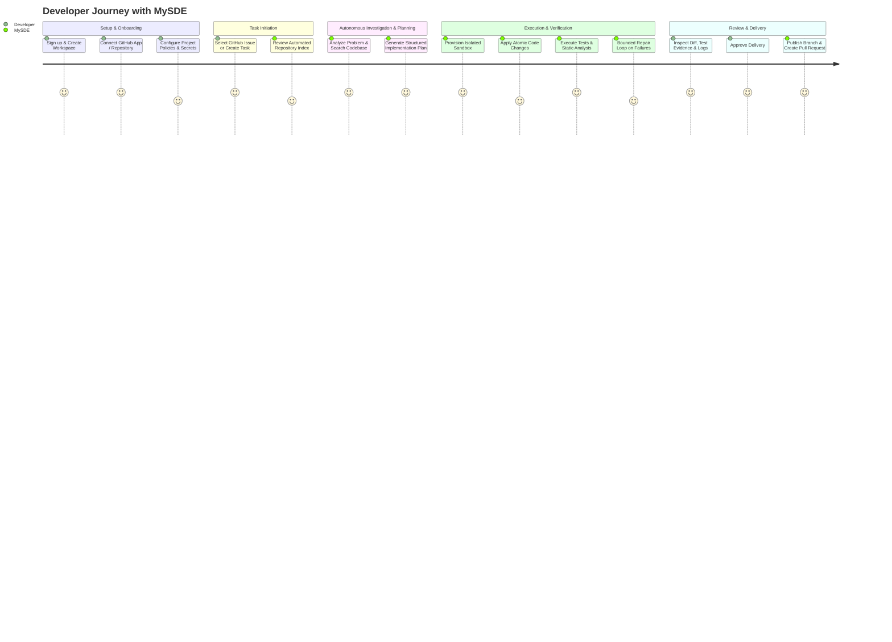

# MySDE — Product Requirements Document (PRD)

**Document Version:** 1.0.0  
**Phase:** Phase 0 & Phase 1 Foundation  
**Status:** Approved  
**Author:** Software Architecture Team  

---

## 1. Executive Summary & Product Vision

**MySDE** is an autonomous AI software engineering SaaS platform designed to transform GitHub issues and feature requests into verified, production-ready, human-reviewable pull requests.

Unlike generic code generation assistants or superficial chat agents, MySDE operates on empirical software engineering principles:
- **Zero Hallucination Tolerance:** Code is never accepted based on an LLM's unsupported claim. Every proposed diff must be compiled, tested, and validated against explicit verification criteria in an isolated sandbox.
- **Traceability & Auditing:** Every decision, tool invocation, repository inspection, diff iteration, and test execution is logged immutably.
- **Human-in-the-Loop Delivery:** The system prepares comprehensive evidence (diffs, test execution logs, static analysis findings, execution traces) and requests explicit developer authorization before pushing branches or opening Pull Requests.

---

## 2. Problem Statement & Target Audience

### 2.1 The Problem
Software development teams spend over 40% of their engineering cycles on routine maintenance, bug fixes, dependency updates, and boilerplate feature implementation. Existing LLM coding tools fall short in production workflows:
1. **Lack of Local Execution Evidence:** In-editor chat tools suggest code snippets without running project-specific test suites or linters.
2. **Context Fragmentation:** LLMs struggle to reason across complex, multi-package repositories without disciplined semantic and AST-level retrieval.
3. **Risk of Regressions:** Without bounded test-repair loops and isolated sandboxes, automated changes introduce silent regressions or security vulnerabilities.
4. **Security & Secrets Exposure:** Developers hesitate to grant external bots access to proprietary codebases without strict multi-tenant boundary isolation and credential redaction.

### 2.2 Target Users
- **Senior Software Engineers & Tech Leads:** Seeking to delegate well-scoped issues, bug fixes, and refactoring tasks without sacrificing code quality or architecture standards.
- **Engineering Managers:** Looking to accelerate team velocity and issue resolution times while retaining strict compliance, auditability, and review gates.
- **Open-Source Maintainers & Small Teams:** Facing large backlogs of community bug reports and PR triage.

---

## 3. Core User Journeys

1. **Onboarding & Configuration:**
   - User signs up, provisions an isolated Workspace, and installs the MySDE GitHub App on selected repositories.
   - User configures project runtime requirements (Python/Node versions, test commands, lint rules).

2. **Issue Selection & Task Ingestion:**
   - User selects an existing GitHub issue or drafts a task specification in MySDE.
   - MySDE ingests issue description, referenced files, and commit history.

3. **Context Retrieval & Planning:**
   - Multi-agent orchestration inspects repository files, dependency graphs, and test targets.
   - Produces a structured implementation plan with step-by-step validation goals.

4. **Sandbox Execution & Bounded Repair:**
   - The task runs in an isolated ephemeral sandbox.
   - Code edits are executed atomically. Tests and linters are executed.
   - If tests fail, the agent engages in a bounded (e.g., max 3-5 iterations) diagnose-and-repair loop with real stderr/stdout feedback.

5. **Review, Approval & Delivery:**
   - The developer inspects the diff viewer, test execution logs, terminal output, and security scan results.
   - Upon explicit approval, MySDE creates a Git branch, pushes commits, and opens a clean GitHub Pull Request referencing the original issue.

---

## 4. MVP Scope & Explicit Non-Goals

### 4.1 In-Scope (MVP - Phases 0 to 4)
- User, Workspace, Project, Repository, Task, and Agent Run data model.
- GitHub App integration for issue reading, branch creation, and PR submission.
- Semantic repository context retrieval (file tree, symbol indexing, grep/search tools).
- Graph-based agent workflow (Analysis -> Planning -> Coding -> Testing -> Review).
- Containerized/Isolated execution sandbox for running tests and linters.
- Human review interface with diff viewer, terminal replay, and test report cards.
- Structured audit logging and secret redaction across all services.

### 4.2 Explicit Non-Goals
- **No Autonomous Auto-Merging:** MySDE will never merge pull requests automatically into default branches.
- **No Arbitrary In-Process Execution:** The FastAPI server will NEVER execute untrusted repository code in its own host process.
- **No Proprietary Vendor Lock-in:** The LLM integration layer must remain agnostic (supporting Anthropic Claude, OpenAI, and local Ollama models).
- **No Mobile Apps:** Native mobile applications are out of scope; a responsive web dashboard is standard.
- **No Full IDE Replacement:** MySDE is a targeted software engineering agent, not an in-browser cloud IDE like VS Code for Web.

---

## 5. Functional Requirements

| ID | Requirement | Description |
|---|---|---|
| **FR-1** | Workspace Isolation | All projects, tasks, credentials, and agent runs must be scoped to a single multi-tenant workspace. |
| **FR-2** | GitHub Connectivity | Connect repositories via GitHub Apps with least-privilege permissions (contents, issues, pull requests). |
| **FR-3** | Task Ingestion | Create tasks from GitHub Issue URLs, webhooks, or manual prompts. |
| **FR-4** | Context Gathering | Search codebase using symbol graphs, file path trees, and semantic vector embeddings. |
| **FR-5** | Execution Sandbox | Execute test suites and commands inside ephemeral containers with strict CPU, memory, and network constraints. |
| **FR-6** | Bounded Self-Healing | Automatically analyze test failure tracebacks and iterate on diffs up to a configurable maximum retry limit. |
| **FR-7** | Evidence Dossier | Store diffs, execution logs, test results, and token costs for every agent run. |
| **FR-8** | Approval Gate | Require explicit user authorization before pushing branches or mutating upstream GitHub state. |

---

## 6. Non-Functional Requirements

- **Reliability:** The core API must provide health (`/health`) and readiness (`/ready`) probes with accurate component-level failure reporting.
- **Security:** Zero plaintext storage of API tokens or private keys. All outbound logs must redact credential patterns. Multi-tenant database policies prevent cross-workspace data access.
- **Performance:** API endpoints must respond within 150ms for non-streaming queries; agent execution steps must stream progress updates via SSE or WebSockets.
- **Maintainability:** Modular monolith architecture with strict separation between API routes, domain services, data repositories, and external integration adapters.
- **Observability:** Structured JSON logging with trace IDs propagating through API requests to background agent tasks.

---

## 7. Acceptance Criteria & Phase Roadmap

### Phase 0 & 1 (Current Milestone)
- [x] Comprehensive architectural, PRD, database, security, and API documentation.
- [x] Backend FastAPI service with Pydantic v2 settings, logging, CORS, and SQLAlchemy 2.x engine lifecycle.
- [x] Alembic migration harness configured with model metadata registry.
- [x] Process health (`GET /health`) and database readiness (`GET /ready`) endpoints.
- [x] Automated test suite verifying health, readiness, and config validation.
- [x] React/Vite/Tailwind frontend shell with graphite/acid-lime design system, responsive navigation, and live API status reporting.

### Phase 2: Workspaces, Projects & GitHub Integration
- Workspace multi-tenancy, user authentication, and GitHub App OAuth/Webhook synchronization.

### Phase 3: Repository Indexing & Agent Orchestration
- Repository AST indexing, LangGraph multi-agent planning and coding pipelines.

### Phase 4: Sandboxed Execution & Delivery
- Isolated Docker/MicroVM sandbox execution, test parsing, bounded self-repair, and PR creation.
